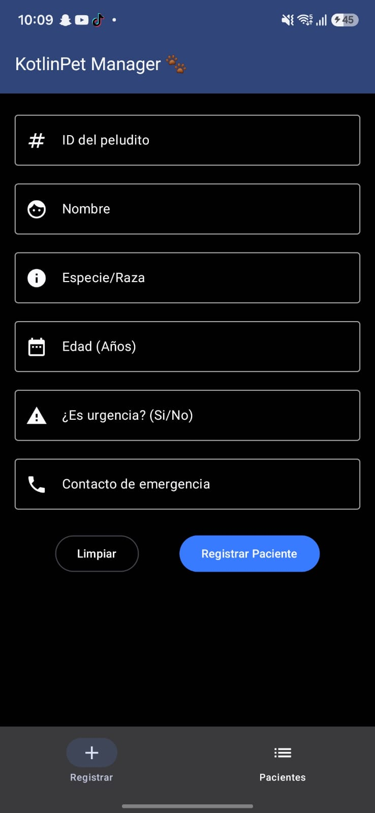
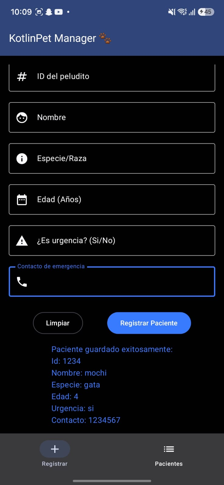
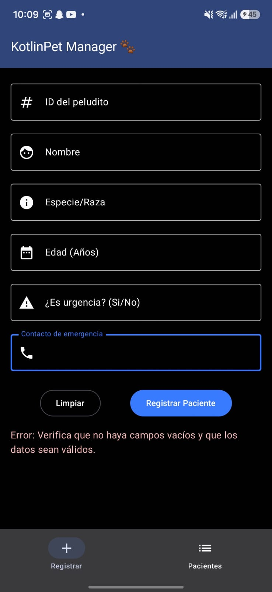
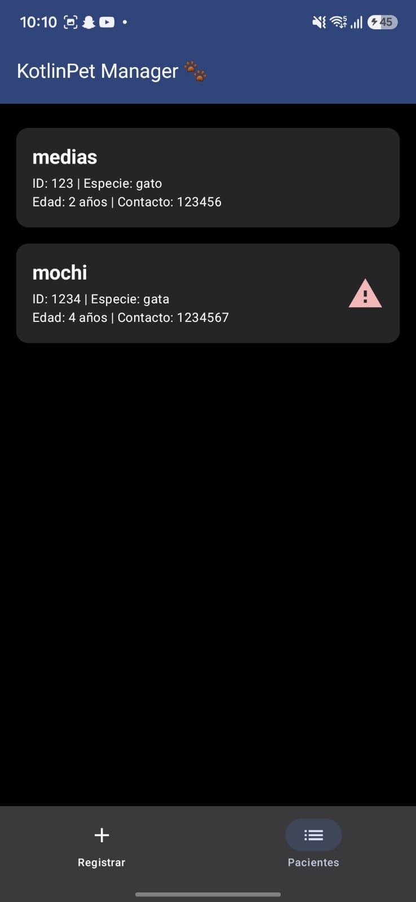

# KotlinPet Manager 🐾

Desarrollo de Aplicativos Móviles (EE053)  
Sebastian Pelaez Chica 
1089097424

##  Descripción
KotlinPet Manager es una aplicación móvil nativa desarrollada en Android
Studio orientada a la gestión de pacientes en clínicas veterinarias.
Permite el registro validado de mascotas y su visualización en tiempo real.

El proyecto destaca por la implementación de una **Arquitectura MVVM** 
robusta, gestión de estado reactivo y un diseño de interfaz modular y 
moderno utilizando **Jetpack Compose** y los componentes de **Material 
Design 3** (Scaffold, ElevatedCard, OutlinedTextField, etc.). Además,
incluye un sistema escalable de navegación multipantalla (BottomNavigation).

## Tecnologías y Herramientas
* **Lenguaje:** Kotlin
* **UI Toolkit:** Jetpack Compose (Material 3)
* **Arquitectura:** MVVM (Model-View-ViewModel)
* **Control de Versiones:** Git & GitHub

## Demostración

